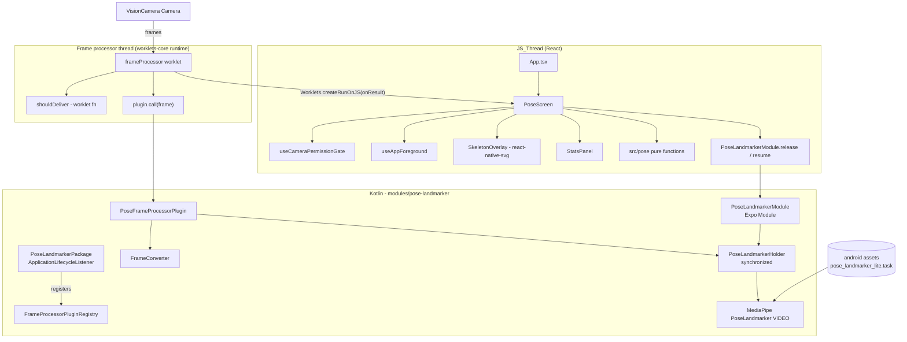
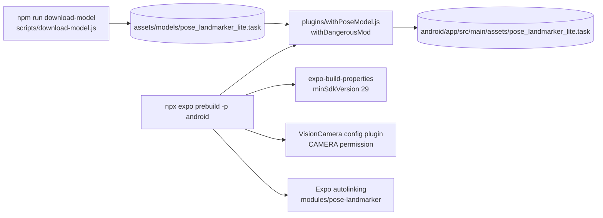
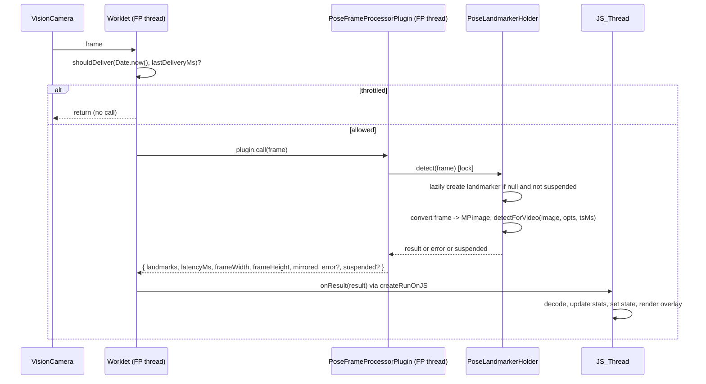

# Design Document: pose-spike

## Overview

PoseSpike is a single-screen Expo + TypeScript Android development build in `PoseSpike/`. It shows a VisionCamera preview, runs MediaPipe PoseLandmarker in Kotlin inside a VisionCamera Frame Processor Plugin, draws a skeleton with react-native-svg, and shows live stats and a status message.

The design keeps three concerns apart:

1. **Native pose path (Kotlin).** A local Expo module at `PoseSpike/modules/pose-landmarker` registers a Frame Processor Plugin named `detectPose`. The plugin runs synchronously on the VisionCamera frame processor thread, converts the frame to an `MPImage`, calls `PoseLandmarker.detectForVideo`, times the call natively, and returns a small result map.
2. **Worklet glue (TypeScript worklet).** The frame processor worklet throttles to at most 30 calls per second, calls the plugin, and hops the result to the JS_Thread with `Worklets.createRunOnJS`.
3. **Pure TypeScript logic.** Landmark decoding, Preview_Mapping, skeleton geometry, sliding-window stats, visibility, status text, and the throttle decision are pure functions in `src/pose/`. They carry the correctness properties and are tested with Jest and fast-check.

### Version policy

All library versions are **"latest stable at implementation time"**. This design does not pin versions. Before pinning, the implementer MUST:

- Run `npx create-expo-app@latest` (blank TypeScript template) and use the Expo SDK it produces.
- Use `npx expo install <pkg>` for Expo-managed packages (expo-dev-client, expo-build-properties, react-native-svg) so versions match the SDK.
- Run `npm view react-native-vision-camera version`, `npm view react-native-worklets-core version`, and check peer-dependency ranges with `npm view <pkg> peerDependencies`.
- Check Maven Central for `com.google.mediapipe:tasks-vision` (https://central.sonatype.com/artifact/com.google.mediapipe/tasks-vision) and use the newest non-alpha release.
- Run `npx expo install --check` and `npx expo-doctor` after installing.
- Record every resolved version in the README (Requirement 11.3).

Reference points from the design author's knowledge, non-binding and possibly out of date: VisionCamera 4.x, react-native-worklets-core 1.x, MediaPipe tasks-vision 0.10.x.

**VisionCamera major-version rule.** Requirement 1.4 mandates react-native-worklets-core. If the latest stable VisionCamera major no longer uses react-native-worklets-core for frame processors (for example, a major that moves to a different worklets runtime or a Nitro-based plugin API), the implementer pins the newest VisionCamera major that still supports react-native-worklets-core Frame Processor Plugins (4.x at the time of writing) and records this in the "Could not verify / may need adjustment" section. API notes for adjusting code are in [VisionCamera API adjustment notes](#visioncamera-api-adjustment-notes).

### Key decisions

| Decision | Choice | Reason |
|---|---|---|
| MediaPipe running mode | `RunningMode.VIDEO` | `detectForVideo` is synchronous and returns the result in the same call, which matches a synchronous Frame Processor Plugin that returns a value. `LIVE_STREAM` delivers results on a listener thread, so the plugin would have to return the previous frame's result or JS would need a second channel. VIDEO also lets native code time the whole call precisely. VIDEO still uses temporal tracking across frames, so accuracy matches LIVE_STREAM. Trade-off: VIDEO blocks the frame processor thread for the inference duration, so VisionCamera drops frames that arrive meanwhile. That is acceptable and is what the FPS stat measures. |
| Delegate | `Delegate.CPU` default, constant `USE_GPU = false` in Kotlin | CPU is the most portable option across test devices. GPU can be tried by flipping one constant. |
| Model variant | `pose_landmarker_lite.task` (float16) | Fastest variant. It is the best first check of real-time feasibility. Full and heavy variants can be swapped by changing one constant and the download URL. |
| Throttle location | In the worklet, before the plugin call | Throttling before inference saves CPU. Each Pose_Call then produces exactly one Landmark_Event, so Pose_FPS equals the inference rate (capped at 30). |
| Bridge payload | Flat `number[]` of 132 values (33 × x, y, z, visibility) plus scalars | Converting one flat number array through JSI is cheaper than converting 33 maps. A pure `decodeLandmarks` turns it into objects on the JS_Thread. |
| minSdk 29 | `expo-build-properties` config plugin | expo-build-properties is an official Expo package maintained in the `expo/expo` repository. This design treats it as an "Expo core package" under Requirement 1.4. The alternative, a custom `withAppBuildGradle` regex edit, is more brittle. If the reviewer rejects this interpretation, replace it with a `withGradleProperties`/`withAppBuildGradle` mod in `plugins/`. |
| Pixel format | VisionCamera `pixelFormat="rgb"` | MediaPipe Tasks accepts Bitmap-backed `MPImage` reliably. With RGBA frames the plugin copies plane 0 into a reused ARGB_8888 Bitmap. A YUV fallback is documented as a Could-not-verify item. |
| Orientation | App locked to portrait (`"orientation": "portrait"` in app.json); rotation passed via `ImageProcessingOptions.setRotationDegrees` | Locking portrait reduces the orientation cases to one per camera. MediaPipe returns landmarks normalized to the rotated (upright) image. |
| Test tooling | Jest (`jest-expo` preset) + fast-check, dev dependencies only | Runtime dependencies stay within Requirement 1.4. |

## Architecture



### Build-time flow



### Frame path sequence



## Components and Interfaces

### Native: `modules/pose-landmarker` (Kotlin)

Package: `expo.modules.poselandmarker`. Every Kotlin method gets a one-line KDoc comment (Requirement 10.1).

#### `PoseLandmarkerPackage.kt`

Registers the Frame Processor Plugin once per process, at application start, before JS can call `VisionCameraProxy.initFrameProcessorPlugin`.

```kotlin
package expo.modules.poselandmarker

import android.app.Application
import android.content.Context
import com.mrousavy.camera.frameprocessors.FrameProcessorPluginRegistry
import expo.modules.core.interfaces.ApplicationLifecycleListener
import expo.modules.core.interfaces.Package

/** Expo package that hooks app start to register the VisionCamera plugin. */
class PoseLandmarkerPackage : Package {
  /** Returns the lifecycle listener that performs plugin registration. */
  override fun createApplicationLifecycleListeners(context: Context): List<ApplicationLifecycleListener> =
    listOf(object : ApplicationLifecycleListener {
      /** Registers the "detectPose" frame processor plugin with VisionCamera. */
      override fun onCreate(application: Application) {
        PoseLandmarkerHolder.init(application.applicationContext)
        FrameProcessorPluginRegistry.addFrameProcessorPlugin("detectPose") { proxy, options ->
          PoseFrameProcessorPlugin(proxy, options)
        }
      }
    })
}
```

Expo autolinking discovers classes implementing `expo.modules.core.interfaces.Package` in the module's Android sources. If it does not on the resolved Expo SDK, the fallback is a static `init {}` block in `PoseLandmarkerModule`'s companion object plus an `OnCreate {}` registration in the module definition, with the JS side calling `PoseLandmarker.ensureRegistered()` before `initFrameProcessorPlugin`.

#### `PoseFrameProcessorPlugin.kt`

```kotlin
/** VisionCamera plugin that runs PoseLandmarker on each frame it is called with. */
class PoseFrameProcessorPlugin(proxy: VisionCameraProxy, options: Map<String, Any>?) :
  FrameProcessorPlugin() {

  /** Runs one Pose_Call on the frame and returns a JS-convertible result map. */
  override fun callback(frame: Frame, arguments: Map<String, Any>?): Any? =
    PoseLandmarkerHolder.detect(frame).toMap()
}
```

Return value shape (all numbers as `Double`, lists as `List<Double>`; VisionCamera converts these to JS values):

| Key | Type | Meaning |
|---|---|---|
| `landmarks` | `List<Double>` length 0 or 132 | Flat `[x0, y0, z0, v0, x1, …]`, normalized to the upright frame. Empty when no person, on error, or when suspended. |
| `latencyMs` | `Double` | Native_Latency: time from callback entry to result creation (conversion + inference), from `SystemClock.elapsedRealtimeNanos()`. |
| `frameWidth`, `frameHeight` | `Double` | Upright frame size in pixels (width/height swapped when rotation is 90 or 270). Needed for aspect-fill mapping. |
| `mirrored` | `Boolean` | `frame.isMirrored` passed through, for diagnostics only. Mirroring for drawing is decided by the active camera position in JS. |
| `error` | `String?` | Present only when the model failed to load. |
| `suspended` | `Boolean?` | Present and `true` only when the holder is released for background. The worklet drops such results. |

`frameWidth`, `frameHeight`, `mirrored`, `error`, and `suspended` are metadata of the Landmark_Result. They do not add frames, pixels, or other bulk data to the bridge, so Requirement 4.3 still holds.

#### `PoseLandmarkerHolder.kt`

A Kotlin `object` that owns the single `PoseLandmarker` and serializes access with one lock.

```kotlin
/** Owns the PoseLandmarker instance and serializes inference, release, and re-creation. */
object PoseLandmarkerHolder {
  private const val MODEL_ASSET = "pose_landmarker_lite.task"
  private const val USE_GPU = false
  private val lock = Any()
  private lateinit var appContext: Context
  private var landmarker: PoseLandmarker? = null
  private var loadError: String? = null
  private var suspended = false
  private var lastTimestampMs = -1L
  private val converter = FrameConverter()

  /** Stores the application context used to open model assets. */
  fun init(context: Context) { appContext = context }

  /** Runs detection on one frame, creating the landmarker lazily; never throws. */
  fun detect(frame: Frame): PoseResult = synchronized(lock) { /* see algorithm */ }

  /** Closes the landmarker and blocks lazy re-creation until resume(). */
  fun release() = synchronized(lock) {
    landmarker?.close(); landmarker = null; suspended = true; lastTimestampMs = -1L
  }

  /** Allows the next detect() to re-create the landmarker; clears any stored load error. */
  fun resume() = synchronized(lock) { suspended = false; loadError = null }

  /** Builds a PoseLandmarker in VIDEO mode from the bundled asset. */
  private fun create(): PoseLandmarker { /* BaseOptions.setModelAssetPath(MODEL_ASSET), RunningMode.VIDEO, numPoses = 1 */ }
}
```

`detect(frame)` algorithm (inside the lock):

1. `start = elapsedRealtimeNanos()`.
2. If `suspended`, return `PoseResult.suspended()`.
3. If `landmarker == null` and `loadError == null`, try `create()`. On any `Throwable`, store `loadError = "Model failed to load: ${e.message}"` and log it with `Log.e`.
4. If `loadError != null`, return `PoseResult.error(loadError)`. The holder does not retry on every frame. It retries after the next `resume()` (foreground), which keeps a broken model from re-throwing 30 times per second.
5. `rotation = FrameConverter.rotationDegrees(frame)`; `image = converter.toMPImage(frame)`.
6. `tsMs = max(frame.timestamp / 1_000_000, lastTimestampMs + 1)`, then store it in `lastTimestampMs`. VIDEO mode requires strictly increasing timestamps per landmarker instance. `frame.timestamp` is in nanoseconds on Android in VisionCamera 4 (verify). The `max` guard protects against equal or regressing values, and `release()` resets it because a new instance starts fresh.
7. `result = landmarker.detectForVideo(image, ImageProcessingOptions.builder().setRotationDegrees(rotation).build(), tsMs)`.
8. Flatten `result.landmarks().firstOrNull()` into 132 doubles, using `lm.visibility().orElse(0f)`. If no pose was detected, return an empty list.
9. `latencyMs = (elapsedRealtimeNanos() - start) / 1e6`. Return the result with upright dimensions (`if (rotation % 180 == 0) w×h else h×w`).
10. Any exception thrown in steps 5–8 is caught, logged, and returned as an empty-landmark result, so a bad frame cannot crash the frame processor thread.

**Thread safety.** `detect` runs on the frame processor thread. `release`/`resume` run on the Expo module's call thread. All three take the same lock:

- If `release()` arrives during an in-flight `detectForVideo`, it blocks until inference finishes and then closes the instance. `close()` is never called on an instance that is in use.
- If a frame that was already queued arrives after `release()`, `suspended` makes it return immediately. Without this flag, a late frame would lazily re-create the landmarker while the app is in the background.
- On foreground, JS calls `resume()`. The next frame re-creates the landmarker before its Pose_Call (Requirement 9.2).

Holding the lock across inference means `release()` can wait up to one inference duration (tens of ms). That is acceptable for a background transition.

#### `FrameConverter.kt`

```kotlin
/** Converts VisionCamera frames into MediaPipe MPImages, reusing one Bitmap. */
class FrameConverter {
  private var bitmap: Bitmap? = null
  private var rowBuffer: ByteBuffer? = null

  /** Copies the RGBA frame's plane 0 into a reused ARGB_8888 Bitmap and wraps it as MPImage. */
  fun toMPImage(frame: Frame): MPImage { /* handles rowStride != width * 4 by row-wise copy */ }

  companion object {
    /** Returns the clockwise rotation in degrees that makes the frame upright. */
    fun rotationDegrees(frame: Frame): Int { /* maps frame.orientation to 0/90/180/270 */ }
  }
}
```

- The Bitmap is reallocated only when the frame size changes (for example, after a camera switch).
- When `planes[0].rowStride == width * 4`, use `bitmap.copyPixelsFromBuffer(buffer)` directly. Otherwise copy row by row into `rowBuffer` first.
- `rotationDegrees` is the one place that interprets VisionCamera's orientation value. If the skeleton appears rotated by 90° or 180° on device, the fix belongs only in this function (see Could-not-verify).

#### `PoseLandmarkerModule.kt` (Expo Module)

```kotlin
/** Expo module exposing landmarker lifecycle control to JavaScript. */
class PoseLandmarkerModule : Module() {
  /** Declares the module name and its JS-callable functions. */
  override fun definition() = ModuleDefinition {
    Name("PoseLandmarker")
    /** Bridge_Method: closes the PoseLandmarker and pauses re-creation (app backgrounded). */
    Function("release") { PoseLandmarkerHolder.release() }
    /** Bridge_Method: allows the PoseLandmarker to be re-created on the next frame (app foregrounded). */
    Function("resume") { PoseLandmarkerHolder.resume() }
  }
}
```

#### `android/build.gradle` (module)

- Applies the Expo module Gradle conventions generated by `npx create-expo-module --local`.
- `implementation "com.google.mediapipe:tasks-vision:<latest stable>"`.
- `implementation project(':react-native-vision-camera')`. This gives access to `Frame`, `FrameProcessorPlugin`, `FrameProcessorPluginRegistry`, and `VisionCameraProxy`. The Gradle project name comes from React Native autolinking, so verify it in `android/settings.gradle` after prebuild.
- `minSdkVersion` is inherited from the root project, which expo-build-properties sets to 29.

#### `expo-module.config.json`

```json
{ "platforms": ["android"], "android": { "modules": ["expo.modules.poselandmarker.PoseLandmarkerModule"] } }
```

### Module TypeScript: `modules/pose-landmarker/`

```ts
// modules/pose-landmarker/src/PoseLandmarkerModule.ts
import { requireNativeModule } from 'expo-modules-core';

interface PoseLandmarkerNative {
  /** Bridge_Method: closes the native PoseLandmarker and pauses re-creation (call on background). */
  release(): void;
  /** Bridge_Method: lets the native PoseLandmarker be re-created on the next frame (call on foreground). */
  resume(): void;
}

export default requireNativeModule<PoseLandmarkerNative>('PoseLandmarker');
```

```ts
// modules/pose-landmarker/index.ts
export { default as PoseLandmarker } from './src/PoseLandmarkerModule';
export { detectPose } from './src/detectPose';
export type { RawPoseResult } from './src/types';
```

```ts
// modules/pose-landmarker/src/detectPose.ts
import { VisionCameraProxy, type Frame } from 'react-native-vision-camera';
import type { RawPoseResult } from './types';

const plugin = VisionCameraProxy.initFrameProcessorPlugin('detectPose', {});

/** Bridge_Method: runs native PoseLandmarker on one frame (worklet, frame processor thread). */
export function detectPose(frame: Frame): RawPoseResult {
  'worklet';
  if (plugin == null) {
    return { landmarks: [], latencyMs: 0, frameWidth: 0, frameHeight: 0, mirrored: false,
             error: 'Pose plugin "detectPose" is not registered' };
  }
  return plugin.call(frame) as unknown as RawPoseResult;
}
```

```ts
// modules/pose-landmarker/src/types.ts
/** Raw Landmark_Result as returned by the native plugin. */
export interface RawPoseResult {
  landmarks: number[];   // length 0 or 132
  latencyMs: number;
  frameWidth: number;    // upright frame width in px
  frameHeight: number;   // upright frame height in px
  mirrored: boolean;
  error?: string;
  suspended?: boolean;
}
```

### App TypeScript

#### `src/hooks/usePoseFrameProcessor.ts`

```ts
import { useFrameProcessor } from 'react-native-vision-camera';
import { Worklets, useSharedValue } from 'react-native-worklets-core';
import { detectPose, type RawPoseResult } from 'pose-landmarker';
import { shouldDeliver } from '../pose/throttle';

/** Returns a frame processor that throttles, runs detectPose, and hands results to onResult on the JS_Thread. */
export function usePoseFrameProcessor(onResult: (r: RawPoseResult) => void) {
  const lastDeliveryMs = useSharedValue(-Infinity);
  // Bridge_Method: hops a Landmark_Result from the frame processor thread to the JS_Thread.
  const onResultJS = Worklets.createRunOnJS(onResult);

  return useFrameProcessor((frame) => {
    'worklet';
    const now = Date.now();
    if (!shouldDeliver(now, lastDeliveryMs.value)) return;
    lastDeliveryMs.value = now;
    const result = detectPose(frame);
    if (result.suspended) return;
    onResultJS(result);
  }, [onResultJS]);
}
```

- `onResult` must be stable (wrapped in `useCallback`) so `createRunOnJS` is not re-created every render. If `createRunOnJS` needs memoizing on the resolved worklets-core version, wrap it in `useMemo`.
- If `Date.now()` is unavailable in the worklet runtime, use `frame.timestamp / 1e6` (Android, nanoseconds). Both are monotonic enough for throttling.
- The throttle starts before the plugin call, so suspended or error results still count against the rate cap.

#### `src/hooks/useAppForeground.ts`

Subscribes to `AppState`. It returns `true` only when the state is `'active'` and calls `onBackground` / `onForeground` on transitions. `PoseScreen` passes `PoseLandmarker.release` and `PoseLandmarker.resume`.

Background order: set `isActive=false` (React state), then call `PoseLandmarker.release()`. Frames that are still in flight return `suspended`. Foreground order: call `PoseLandmarker.resume()`, then set `isActive=true`.

#### `src/hooks/useCameraPermissionGate.ts`

```ts
type PermissionUiState = 'checking' | 'granted' | 'denied';
/** Requests camera permission once on mount and re-checks it on every return to foreground. */
export function useCameraPermissionGate(isForeground: boolean): {
  state: PermissionUiState; openSettings: () => void;
};
```

- Uses VisionCamera `useCameraPermission()` for `hasPermission` and `requestPermission`.
- On mount: if `!hasPermission` and the gate has not requested yet in this session, call `requestPermission()` (Requirement 3.1). Result `false` → `'denied'`.
- On each transition to foreground: call `Camera.getCameraPermissionStatus()` (synchronous in v4) and set `'granted'` if it returns `'granted'` (Requirement 3.5). This covers versions where `useCameraPermission` does not refresh on AppState changes.
- `openSettings` calls `Linking.openSettings()` (Requirement 3.4).

#### `src/screens/PoseScreen.tsx`

State: `cameraPosition: 'front' | 'back'` (default `'front'`), `viewSize`, `latest: PoseFrame | null`, `stats: StatsState`, `modelError: string | null`.

- `device = useCameraDevice(cameraPosition)`.
- `format = useCameraFormat(device, [{ fps: 30 }, { videoResolution: { width: 640, height: 480 } }])`. A low resolution keeps the RGBA copy cheap.
- `<Camera style={StyleSheet.absoluteFill} device={device} format={format} fps={30} isActive={isForeground && permission === 'granted'} pixelFormat="rgb" resizeMode="cover" frameProcessor={frameProcessor} />`.
- `onLayout` on the container sets `viewSize`.
- `onResult` (stable `useCallback`):
  - If `r.error` is set: set `modelError`, set `latest` to an empty frame, and do not add a stats sample.
  - Otherwise: `latest = { landmarks: decodeLandmarks(r.landmarks), frameWidth, frameHeight }` and `stats = addSample(stats, Date.now(), r.latencyMs)`.
- A 500 ms `setInterval` tick calls `setNow(Date.now())`, so the displayed stats age out when events stop. The view computes `computeStats(stats, now)`.
- `useEffect` on `cameraPosition` → `setStats(resetStats())` (Requirement 8.2).
- Reset button → `setStats(resetStats())` (Requirement 6.4).
- Rendering:
  - Permission `'denied'`: message "Camera access is required to track your pose." and an "Open Settings" button.
  - `modelError` set: an error banner with the text from `modelErrorMessage(modelError)`.
  - Otherwise: camera, `SkeletonOverlay`, `StatsPanel`, Status_Message, Camera_Toggle, and Reset_Stats_Button.

#### `src/components/SkeletonOverlay.tsx`

An `<Svg>` absolutely positioned over the camera with `pointerEvents="none"`. It calls `buildSkeleton(landmarks, mapping)` and renders `<Line>` for each line and `<Circle r={5}>` for each dot. With empty landmarks it renders an empty `<Svg>` (Requirement 5.6).

#### `src/components/StatsPanel.tsx`

Displays `Pose FPS: {fps.toFixed(1)}`, `Latency: {avgLatencyMs.toFixed(1)} ms` (`--` when null), and `Visibility: {formatVisibility(keyVisibility)}`.

### Pure TypeScript modules (`src/pose/`)

Functions that run inside the worklet carry the `'worklet'` directive. Jest ignores the directive, so the same code is unit-testable.

```ts
// constants.ts
export const LANDMARK_COUNT = 33;
export const VALUES_PER_LANDMARK = 4;
export const KEY_LANDMARKS = [11, 12, 13, 14, 23, 24, 25, 26, 27, 28] as const;
export const SKELETON_JOINTS = [11, 12, 13, 14, 15, 16, 23, 24, 25, 26, 27, 28] as const;
export const SKELETON_SEGMENTS: ReadonlyArray<readonly [number, number]> = [
  [11, 12], [11, 13], [12, 14], [13, 15], [14, 16],
  [11, 23], [12, 24], [23, 24], [23, 25], [24, 26], [25, 27], [26, 28],
];
export const VISIBILITY_THRESHOLD = 0.6;
export const MAX_EVENTS_PER_SECOND = 30;
export const STATS_WINDOW_MS = 2000;
export const STATUS_VISIBLE = 'Body fully visible';
export const STATUS_NOT_VISIBLE = 'Move back or improve lighting';
```

```ts
// landmarks.ts
export interface Landmark { x: number; y: number; z: number; visibility: number }
/** Decodes the plugin's flat 132-number array into 33 landmarks; any other length yields []. */
export function decodeLandmarks(flat: readonly number[]): Landmark[];
/** Encodes landmarks into the flat layout (test helper, mirrors the Kotlin flattening). */
export function encodeLandmarks(lms: readonly Landmark[]): number[];
/** Mean visibility of KEY_LANDMARKS, or null when landmarks are empty. */
export function keyLandmarkVisibility(lms: readonly Landmark[]): number | null;
/** True iff landmarks are non-empty and every KEY_LANDMARK visibility is strictly > 0.6. */
export function isFullBodyVisible(lms: readonly Landmark[]): boolean;
/** Status_Message text for the given landmarks. */
export function statusMessage(lms: readonly Landmark[]): string;
/** Formats visibility clamped to [0,1] with two decimals, or "--" for null. */
export function formatVisibility(v: number | null): string;
/** User-facing model-load error text; always starts with "Model failed to load". */
export function modelErrorMessage(raw: string): string;
```

```ts
// previewMapping.ts
export interface MappingParams {
  viewWidth: number; viewHeight: number;    // preview view size (dp)
  frameWidth: number; frameHeight: number;  // upright frame size (px)
  mirrored: boolean;                        // true for front camera
}
/** Maps a normalized landmark (0..1 of upright frame) to preview coordinates with aspect-fill crop and optional mirroring. */
export function mapPoint(nx: number, ny: number, p: MappingParams): { x: number; y: number };
```

Aspect-fill (`resizeMode="cover"`) algorithm:

```
scale   = max(viewWidth / frameWidth, viewHeight / frameHeight)
scaledW = frameWidth * scale
scaledH = frameHeight * scale
offsetX = (viewWidth  - scaledW) / 2      // <= 0, the cropped half-width
offsetY = (viewHeight - scaledH) / 2      // <= 0
x = offsetX + nx * scaledW
y = offsetY + ny * scaledH
if mirrored: x = viewWidth - x
```

If `frameWidth` or `frameHeight` is ≤ 0 (no frame yet, or an error result), `buildSkeleton` returns empty output and `mapPoint` is not called.

The frame dimensions come from the native result and are already upright (rotation applied), so the mapping needs no rotation logic of its own. Mirroring uses the JS camera position (`cameraPosition === 'front'`). VisionCamera mirrors the front preview but not the frame buffer (verify on device).

```ts
// skeleton.ts
export interface SkeletonGeometry {
  lines: Array<{ from: number; to: number; x1: number; y1: number; x2: number; y2: number }>;
  dots: Array<{ index: number; x: number; y: number }>;
}
/** Builds SKELETON_SEGMENTS lines and SKELETON_JOINTS dots via mapPoint; empty for empty landmarks or invalid frame size. */
export function buildSkeleton(lms: readonly Landmark[], p: MappingParams): SkeletonGeometry;
```

```ts
// stats.ts
export interface StatsSample { t: number; latencyMs: number }
export interface StatsState { samples: StatsSample[]; startedAt: number | null }
export interface StatsView { fps: number; avgLatencyMs: number | null }
/** Fresh state with no samples (used by Reset_Stats_Button and camera switch). */
export function resetStats(): StatsState;
/** Appends a sample at time t and drops samples older than the 2 s window. */
export function addSample(s: StatsState, t: number, latencyMs: number): StatsState;
/** Pose_FPS and mean Native_Latency over the window (now - 2000, now]. */
export function computeStats(s: StatsState, now: number): StatsView;
```

`computeStats` definition:

- `window = samples with now - 2000 < t <= now`, `n = window.length`.
- `avgLatencyMs = n === 0 ? null : mean(window.latencyMs)`.
- `elapsed = startedAt === null ? 0 : now - startedAt`, where `startedAt` is the time of the first sample after a reset.
- Steady state (`elapsed >= 2000`): `fps = n / 2`.
- Warm-up (`0 < elapsed < 2000`): `fps = (n - 1) / (elapsed / 1000)`, which counts intervals between samples so the rate is not overstated in the first moments.
- `elapsed <= 0` or `n === 0`: `fps = 0`.

```ts
// throttle.ts
/** Worklet: true iff at least 1000/30 ms passed since the last delivery (integer-safe: (now - last) * 30 >= 1000). */
export function shouldDeliver(nowMs: number, lastMs: number): boolean {
  'worklet';
  return (nowMs - lastMs) * MAX_EVENTS_PER_SECOND >= 1000;
}
```

Because accepted deliveries are at least 1000/30 ms apart, any half-open 1000 ms window contains at most 30 of them (Requirement 4.4). With a 30 fps camera, jitter makes the throttle drop some frames, so observed Pose_FPS can be in the mid-20s. The README notes this.

### Build tooling

#### `scripts/download-model.js` (Node, built-in modules only)

- Constants:
  - `MODEL_URL = process.env.POSE_MODEL_URL ?? 'https://storage.googleapis.com/mediapipe-models/pose_landmarker/pose_landmarker_lite/float16/latest/pose_landmarker_lite.task'`
  - `DEST = path.join(__dirname, '..', 'assets', 'models', 'pose_landmarker_lite.task')`
- If `DEST` exists and is non-empty: print `Model already present at <DEST>, skipping download.` and exit 0 (Requirement 2.2).
- Otherwise: `fs.mkdirSync(dir, { recursive: true })` and `https.get`, following up to 5 redirects (3xx with `location`). A non-2xx final status rejects with `HTTP <code> <message>`.
- Stream the response to `DEST + '.part'`, then `fs.renameSync` to `DEST` on finish. A failed download never leaves a half-written file that the next run would skip.
- On any error: delete `.part`, print `Model download failed: <reason>` to stderr, and `process.exit(1)` (Requirement 2.3).
- `package.json` script: `"download-model": "node scripts/download-model.js"`.

#### `plugins/withPoseModel.js` (Model_Config_Plugin)

```js
const { withDangerousMod } = require('expo/config-plugins');
const fs = require('fs');
const path = require('path');

const MODEL_NAME = 'pose_landmarker_lite.task';

/** Copies the model from assets/models into android/app/src/main/assets; throws if the model is missing. */
function copyModel(projectRoot, platformProjectRoot) {
  const src = path.join(projectRoot, 'assets', 'models', MODEL_NAME);
  if (!fs.existsSync(src)) {
    throw new Error(`[withPoseModel] ${MODEL_NAME} not found at ${src}. Run "npm run download-model" first.`);
  }
  const destDir = path.join(platformProjectRoot, 'app', 'src', 'main', 'assets');
  fs.mkdirSync(destDir, { recursive: true });
  fs.copyFileSync(src, path.join(destDir, MODEL_NAME));
}

/** Expo config plugin: runs copyModel during the Android dangerous-mod phase of prebuild. */
module.exports = function withPoseModel(config) {
  return withDangerousMod(config, ['android', async (cfg) => {
    copyModel(cfg.modRequest.projectRoot, cfg.modRequest.platformProjectRoot);
    return cfg;
  }]);
};
module.exports.copyModel = copyModel;
```

Throwing inside a mod makes `expo prebuild` exit non-zero and print the message (Requirement 2.5). `copyModel` is exported for a Jest test that uses a temp directory.

#### `app.json` (relevant parts)

```json
{
  "expo": {
    "name": "PoseSpike",
    "slug": "pose-spike",
    "orientation": "portrait",
    "android": { "package": "com.example.posespike" },
    "plugins": [
      ["react-native-vision-camera", { "cameraPermissionText": "PoseSpike uses the camera to track your pose on-device.", "enableMicrophonePermission": false }],
      ["expo-build-properties", { "android": { "minSdkVersion": 29 } }],
      "./plugins/withPoseModel"
    ]
  }
}
```

#### `babel.config.js`

`presets: ['babel-preset-expo']` and `plugins: ['react-native-worklets-core/plugin']`. If the resolved Expo SDK auto-includes a Reanimated babel plugin, make sure it does not conflict. Reanimated is not a dependency.

#### `package.json` dependencies

- Runtime: `expo`, `react`, `react-native` (from the template), `expo-dev-client`, `expo-build-properties`, `expo-status-bar` (from the template), `react-native-vision-camera`, `react-native-worklets-core`, `react-native-svg`, and `"pose-landmarker": "file:./modules/pose-landmarker"`. Expo SDK 50+ also autolinks `modules/` without a dependency entry; keep the `file:` entry only if module resolution by name requires it.
- Dev only: `typescript`, `@types/react`, `jest`, `jest-expo`, `@types/jest`, `fast-check`.
- Scripts: `download-model`, `prebuild` (`expo prebuild -p android`), `android` (`expo run:android`), `test` (`jest`), `typecheck` (`tsc --noEmit`).

### VisionCamera API adjustment notes

Exact APIs vary between VisionCamera releases. The implementer checks these against the installed version's docs and adjusts only the files listed:

| API used | Assumed (v4) | If it differs | File |
|---|---|---|---|
| Plugin registry | `com.mrousavy.camera.frameprocessors.FrameProcessorPluginRegistry.addFrameProcessorPlugin(name) { proxy, options -> }` | Older 3.x used `FrameProcessorPlugin.register`, and package paths moved between 3.x and 4.x | `PoseLandmarkerPackage.kt` |
| Plugin base class | `FrameProcessorPlugin` with `callback(frame: Frame, arguments: Map<String, Any>?): Any?` | Constructor or signature changes | `PoseFrameProcessorPlugin.kt` |
| Frame accessors | `frame.image`, `frame.width`, `frame.height`, `frame.orientation`, `frame.isMirrored`, `frame.timestamp` | Orientation semantics changed within 4.x (sensor vs. preview-relative) | `FrameConverter.kt` |
| JS plugin init | `VisionCameraProxy.initFrameProcessorPlugin(name, options)` | Name or return type changes | `detectPose.ts` |
| JS hop | `Worklets.createRunOnJS(fn)` from react-native-worklets-core | Older: `Worklets.createRunInJsFn`; newer: `runOnJS` helpers | `usePoseFrameProcessor.ts` |
| Shared value | `useSharedValue` from react-native-worklets-core | Use `Worklets.createSharedValue` in `useMemo` | `usePoseFrameProcessor.ts` |
| Permission | `useCameraPermission()`, `Camera.getCameraPermissionStatus()` | Async status getter | `useCameraPermissionGate.ts` |

## Data Models

```ts
/** Decoded result kept in PoseScreen state. */
interface PoseFrame {
  landmarks: Landmark[];      // [] or 33 items
  frameWidth: number;         // upright px
  frameHeight: number;        // upright px
}
```

Flat landmark layout shared by Kotlin and TypeScript: index `i * 4 + k` with `k = 0:x, 1:y, 2:z, 3:visibility`, for `i` in `0..32`. x and y are normalized to [0,1] of the upright frame. MediaPipe can return values slightly outside [0,1] for off-frame joints, and `mapPoint` handles them without clamping. z is relative depth. Visibility is in [0,1], with 0 when MediaPipe omits it.

Kotlin `PoseResult` (internal):

```kotlin
/** Internal result of one Pose_Call before conversion to a JS map. */
data class PoseResult(
  val landmarks: List<Double>, val latencyMs: Double,
  val frameWidth: Int, val frameHeight: Int, val mirrored: Boolean,
  val error: String? = null, val suspended: Boolean = false,
) { /** Converts to a VisionCamera-compatible map for return to JS. */ fun toMap(): Map<String, Any> }
```

No persistent storage, no network models, no backend (Requirement 10.3).

## Error Handling

| Condition | Where detected | Behaviour |
|---|---|---|
| Model asset missing at prebuild | `withPoseModel.copyModel` | Throws an error naming `npm run download-model`, and prebuild fails (Requirement 2.5). |
| Model download fails (DNS, non-2xx, write error) | `download-model.js` | Deletes `.part`, prints `Model download failed: <reason>`, exits 1 (Requirement 2.3). |
| PoseLandmarker creation throws (asset missing or compressed, bad file, unsupported delegate) | `PoseLandmarkerHolder.create` | Stores `loadError`, logs it, and returns `error` on each call without retrying until `resume()`. JS shows "Model failed to load: …" (Requirement 4.6). |
| Plugin not registered (`initFrameProcessorPlugin` returns undefined) | `detectPose.ts` | Returns `error`, and the same banner is shown. |
| Exception during conversion or inference for one frame | `PoseLandmarkerHolder.detect` | Logs it and returns empty landmarks. The UI shows the not-visible status. |
| No person detected | MediaPipe returns no poses | Empty landmarks: skeleton cleared, status "Move back or improve lighting" (Requirements 4.7, 5.6, 7.2). |
| Frame after `release()` | `suspended` flag | Returns `suspended`, which the worklet drops. |
| Non-increasing frame timestamp | `max(ts, last + 1)` guard | Prevents MediaPipe's VIDEO-mode timestamp exception. |
| No camera device for position | `useCameraDevice` returns undefined | Shows "No <front/back> camera found". The toggle stays usable. |
| Permission denied | `useCameraPermissionGate` | Shows the denied message and "Open Settings" (Requirement 3.3). |
| Frame size 0 / no layout yet | `buildSkeleton` guard | Draws nothing. |

## Project File Tree

```
PoseSpike/
├── .gitignore                      # node_modules, android/, ios/, assets/models/*.task
├── App.tsx                         # renders PoseScreen
├── README.md
├── app.json
├── babel.config.js
├── index.ts                        # registerRootComponent(App)
├── jest.config.js                  # preset: jest-expo
├── package.json
├── tsconfig.json
├── assets/
│   └── models/
│       └── .gitkeep                # pose_landmarker_lite.task downloaded here
├── plugins/
│   ├── withPoseModel.js
│   └── __tests__/withPoseModel.test.js
├── scripts/
│   └── download-model.js
├── src/
│   ├── components/
│   │   ├── PermissionDenied.tsx
│   │   ├── SkeletonOverlay.tsx
│   │   └── StatsPanel.tsx
│   ├── hooks/
│   │   ├── useAppForeground.ts
│   │   ├── useCameraPermissionGate.ts
│   │   └── usePoseFrameProcessor.ts
│   ├── pose/
│   │   ├── constants.ts
│   │   ├── landmarks.ts
│   │   ├── previewMapping.ts
│   │   ├── skeleton.ts
│   │   ├── stats.ts
│   │   ├── throttle.ts
│   │   └── __tests__/
│   │       ├── arbitraries.ts      # shared fast-check generators
│   │       ├── landmarks.test.ts
│   │       ├── previewMapping.test.ts
│   │       ├── skeleton.test.ts
│   │       ├── stats.test.ts
│   │       ├── throttle.test.ts
│   │       └── dependencies.test.ts # runtime dependency allow-list (Requirement 1.4)
│   └── screens/
│       └── PoseScreen.tsx
└── modules/
    └── pose-landmarker/
        ├── expo-module.config.json
        ├── index.ts
        ├── package.json
        ├── src/
        │   ├── PoseLandmarkerModule.ts
        │   ├── detectPose.ts
        │   └── types.ts
        └── android/
            ├── build.gradle
            └── src/main/
                ├── AndroidManifest.xml
                └── java/expo/modules/poselandmarker/
                    ├── FrameConverter.kt
                    ├── PoseFrameProcessorPlugin.kt
                    ├── PoseLandmarkerHolder.kt
                    ├── PoseLandmarkerModule.kt
                    ├── PoseLandmarkerPackage.kt
                    └── PoseResult.kt
```

The module is scaffolded with `npx create-expo-module@latest --local pose-landmarker`. The implementer deletes the generated iOS and web files and the sample view, because the spike targets Android only.

## README Structure

`PoseSpike/README.md` sections, in order:

1. **What this is.** A one-paragraph spike description.
2. **Prerequisites.** Node LTS, JDK 17, Android SDK and platform tools, a physical Android device (API 29+).
3. **Enable USB debugging.** Settings → About phone → tap Build number 7 times → Developer options → USB debugging on. Connect, accept the RSA prompt, then run `adb devices` and confirm the device shows as `device` (Requirement 11.2).
4. **Setup (exact commands)** (Requirement 11.1):
   ```
   cd PoseSpike
   npm install
   npm run download-model
   npx expo prebuild -p android --clean
   npx expo run:android --device
   ```
   Plus `npx expo start --dev-client` for later JS-only reloads.
5. **Dependency versions.** A table with the exact resolved versions of Expo SDK, React Native, react-native-vision-camera, react-native-worklets-core, react-native-svg, expo-dev-client, expo-build-properties, MediaPipe tasks-vision, Model_File (name, variant, URL, download date), and minSdkVersion 29 (Requirement 11.3).
6. **Project file tree.** The tree above, excluding `node_modules/` and `android/` (Requirement 11.5).
7. **How it works.** A short description of the frame path, throttle, and lifecycle.
8. **Acceptance check procedure.** Five numbered steps matching Requirements 12.1–12.5, each with what to do and what to record (Requirement 12.6):
   1. Launch with permission granted, and confirm the preview.
   2. Stand 2 m away, and confirm the skeleton is aligned.
   3. Watch FPS and latency update. Let them settle for 10 s, then record the values for front and rear cameras.
   4. Step out of frame, and confirm the status changes.
   5. Background for 5 s and resume. Confirm no crash and that the preview and overlay return.
9. **Results.** The table with exactly these columns and blank data cells (Requirement 11.4):
   ```
   | Device model | Android version | Front camera FPS | Rear camera FPS | Latency ms | Notes |
   |---|---|---|---|---|---|
   |  |  |  |  |  |  |
   ```
10. **Running tests.** `npm test`, `npm run typecheck`.
11. **Could not verify / may need adjustment** (Requirements 11.6–11.9). It states that the design was not run on a physical device, because no device was available when it was written. It lists:
    - **Model URL and storage.** The `latest` path on `storage.googleapis.com/mediapipe-models` may move or change content. The local path `assets/models/` and the copy into `android/app/src/main/assets/` are unverified on device. If PoseLandmarker reports a compressed-asset or file-descriptor error, add `androidResources { noCompress 'task' }` to the app Gradle file through a small `withAppBuildGradle` mod.
    - **Version compatibility.** Compatibility between the resolved Expo SDK (including its New Architecture default), React Native, VisionCamera, worklets-core, react-native-svg, and tasks-vision is unverified. This includes the possibility that the latest VisionCamera major drops react-native-worklets-core.
    - **API changes.** VisionCamera plugin registration, Frame accessors, and orientation semantics; worklets-core `createRunOnJS` and `useSharedValue`; MediaPipe `detectForVideo`, `ImageProcessingOptions`, and `MPImage` builders; Expo `Package` lifecycle-listener discovery and `withDangerousMod`. The adjustment table above lists the file to change for each.
    - **Frame conversion.** Whether `pixelFormat="rgb"` yields RGBA_8888 on all test devices. Fallback: use `pixelFormat="yuv"` and add a manual YUV_420_888 to ARGB conversion in `FrameConverter` (RenderScript is deprecated, so it is not used).
    - **Rotation and mirroring.** Whether `rotationDegrees` and front-camera mirroring align the skeleton on each device. The fix is in `FrameConverter.rotationDegrees` or the `mirrored` flag in `PoseScreen`.
    - **Throttle effect.** Whether the 30/s throttle reduces observed FPS below the camera rate because of timestamp jitter.

## Correctness Properties

*A property is a characteristic or behavior that should hold true across all valid executions of a system—essentially, a formal statement about what the system should do. Properties serve as the bridge between human-readable specifications and machine-verifiable correctness guarantees.*

Redundancy review: criteria 5.1, 5.2, and 5.6 all describe the output structure of `buildSkeleton`, so they are combined into Property 3. The 7.1 and 7.2 status messages are two sides of one predicate and are combined into Property 11. The stats-window pruning invariant is implied by the model-based latency property (Property 7), so it has no separate property. The camera-switch reset (8.2) uses the same `resetStats` as 6.4 and is covered by Property 9.

### Property 1: Landmark encoding round trip

*For any* list of 33 landmarks with finite x, y, z and visibility in [0,1], `decodeLandmarks(encodeLandmarks(lms))` equals `lms`. *For any* flat array whose length is not 132 (including the empty array), `decodeLandmarks` returns an empty list.

**Validates: Requirements 4.3, 4.7**

### Property 2: Throttle caps delivery rate

*For any* strictly increasing sequence of frame timestamps in milliseconds, the subsequence accepted by applying `shouldDeliver` in order (updating `last` on each acceptance, starting from `-Infinity`) contains at most 30 timestamps in every half-open interval `[t, t + 1000)`. Every rejected timestamp is less than 1000/30 ms after the most recent accepted one.

**Validates: Requirements 4.4**

### Property 3: Skeleton structure

*For any* list of 33 landmarks and any valid MappingParams (positive view and frame sizes), `buildSkeleton` returns exactly the 12 SKELETON_SEGMENTS index pairs as lines, in order, and exactly the 12 SKELETON_JOINTS indices as dots. *For any* MappingParams, `buildSkeleton` of an empty landmark list returns no lines and no dots.

**Validates: Requirements 5.1, 5.2, 5.6**

### Property 4: Skeleton positions come from Preview_Mapping

*For any* 33 landmarks and valid MappingParams, every dot `(x, y)` equals `mapPoint(lm.x, lm.y, params)` of its landmark. Every line's endpoints equal `mapPoint` of its `from` and `to` landmarks.

**Validates: Requirements 5.3**

### Property 5: Front-camera mirroring is a horizontal reflection

*For any* normalized point `(nx, ny)` and valid MappingParams, `mapPoint(nx, ny, {...p, mirrored: true}).x` equals `p.viewWidth - mapPoint(nx, ny, {...p, mirrored: false}).x`, and the y values are equal.

**Validates: Requirements 5.4, 5.5**

### Property 6: Aspect-fill mapping

*For any* valid MappingParams with `mirrored = false`, `mapPoint` agrees with the reference formula (uniform scale `max(vw/fw, vh/fh)`, centered crop) within 1e-6. It maps `(0.5, 0.5)` to the view center. It maps the frame corners `(0,0)` and `(1,1)` to points at or outside the view rectangle on the cropped axis and exactly onto the view edges on the other axis, so the scaled frame covers the view. *For any* two points with `nx1 < nx2`, the mapped x values satisfy `x1 < x2`.

**Validates: Requirements 5.3, 5.5**

### Property 7: Latency average matches the 2-second window

*For any* sequence of samples `(t, latencyMs)` with non-decreasing `t` added through `addSample` after `resetStats()`, and any `now` at or after the last sample, `computeStats(state, now).avgLatencyMs` equals the arithmetic mean of `latencyMs` over the samples with `now - 2000 < t <= now` (within 1e-9), or `null` when there are none.

**Validates: Requirements 6.2**

### Property 8: FPS measures the delivery rate

*For any* constant period `p` in [10, 200] ms and number of samples `k` ≥ 2 added at times `t0 + i·p`, `computeStats(state, lastT).fps` equals `1000 / p` within 1e-6 while `lastT - t0 < 2000`. Once `lastT - t0 >= 2000`, it equals `n / 2`, where `n` is the number of samples in the window, which is within `0.5` of `1000 / p`.

**Validates: Requirements 6.1**

### Property 9: Reset restarts statistics from zero

*For any* sample sequences `A` and `B` (with B's times after A's), applying `A`, then `resetStats()`, then `B` produces the same `computeStats` output at any `now` as applying only `B` to a fresh state. Immediately after `resetStats()`, `computeStats` returns `fps = 0` and `avgLatencyMs = null`.

**Validates: Requirements 6.4, 8.2**

### Property 10: Key landmark visibility average and format

*For any* 33 landmarks, `keyLandmarkVisibility` equals the arithmetic mean of the visibilities at indices 11, 12, 13, 14, 23, 24, 25, 26, 27, 28 (within 1e-9), and it is `null` for an empty list. *For any* number `v` in [0,1], `formatVisibility(v)` matches `/^[01]\.\d{2}$/` and differs from `v` by at most 0.005.

**Validates: Requirements 6.3**

### Property 11: Full-body status

*For any* 33 landmarks, including visibilities drawn to hit exactly 0.6, `isFullBodyVisible` is true if and only if every key landmark visibility is strictly greater than 0.6. `statusMessage` returns "Body fully visible" exactly when `isFullBodyVisible` is true and "Move back or improve lighting" otherwise. *For an* empty landmark list, `statusMessage` returns "Move back or improve lighting".

**Validates: Requirements 7.1, 7.2**

## Testing Strategy

### Property-based tests (Jest + fast-check, dev dependencies only)

- Each correctness property is one fast-check test with `{ numRuns: 100 }` minimum.
- Each test is tagged with a comment in the form: `// Feature: pose-spike, Property <n>: <property title>`.
- Shared generators in `src/pose/__tests__/arbitraries.ts`:
  - `landmarkArb`: x and y in [-0.2, 1.2], z in [-1, 1], visibility in [0,1], with constant-weighted values 0.6, 0.6 ± ε, 0, and 1 to hit the boundary.
  - `poseArb`: an array of 33 `landmarkArb`.
  - `maybePoseArb`: `poseArb` or `[]`.
  - `mappingArb`: view sizes 100–3000, frame sizes 100–4000, covering portrait, landscape, and square aspects, plus a random `mirrored`.
  - `timestampsArb`: sorted unique integers or doubles with gaps of 0–200 ms.
- Floating-point comparisons use explicit tolerances (1e-6 for geometry, 1e-9 for means).

### Example and unit tests

- `withPoseModel.test.js`: `copyModel` copies into a temp `android/app/src/main/assets`. With a missing source it throws a message containing `npm run download-model`.
- `dependencies.test.ts`: reads `package.json` and asserts `dependencies` ⊆ the allow-list from Requirement 1.4 (Expo packages, `react`, `react-native`, VisionCamera, worklets-core, svg, the local module).
- `landmarks.test.ts`: `modelErrorMessage` example; `formatVisibility(null) === '--'`.
- Download script: manual checks in the README (run twice for the skip message; run with `POSE_MODEL_URL=https://storage.googleapis.com/mediapipe-models/does-not-exist` to see a non-zero exit). These are not automated because they need the network.

### Device checks (manual, recorded in the README)

The native plugin, permission flow, lifecycle, overlay alignment, and performance (Requirements 3, 4.1, 4.2, 4.5, 4.8, 8.1, 9, 12) depend on the device, camera, and OS. They are verified with the README acceptance procedure on a physical device rather than with automated tests. During the background/resume check, `adb logcat -s PoseLandmarker` shows the release and re-create log lines that confirm Requirement 9.1–9.2.

### Static checks

- `npm run typecheck` (`tsc --noEmit`).
- `./gradlew :pose-landmarker:compileDebugKotlin` (or the full `expo run:android`) to compile the Kotlin module.
- Review that every Kotlin method and every Bridge_Method has a comment (Requirements 10.1, 10.2).
